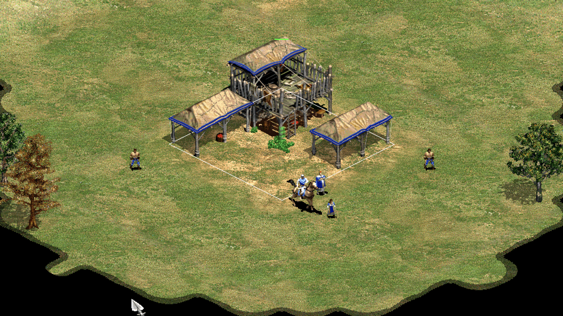
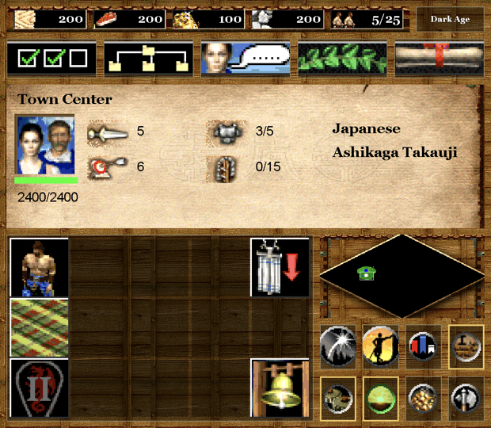

# AoK Thor

Age of Empires II: The Age of Kings (1999) on the AYN Thor, using both screens.
It's a fork of [OpenAoK](https://github.com/Zaydme/openaok), an open-source
engine that runs the original game from your own CD.

- The top screen shows only the map, with pixel-perfect 2x scaling.
- The bottom touchscreen shows the game's interface, using the original art.
- The Thor's controls are fully mapped: the left stick moves the cursor and the
  buttons trigger the game's shortcuts.
- An optional CRT filter for both screens.

Smaller improvements:

- Zoom from 35% to 300%, snapping to 100%, 200% and 300%.
- Control groups from the controller.
- Menus and windows scaled up to fill the screen, all at the same size. The
  technology tree scrolls with a finger or the right stick.

<p align="center">
  
  <br>
  
</p>

## What you need

- An AYN Thor (tested on Android 13).
- The original 1999 Age of Kings CD (tested with the English version 1.0). The
  Conquerors, HD and Definitive Edition are not supported.
- A computer with Python 3, CMake, cabextract and a C++ compiler, to prepare
  the game data once.

This repository and the APK contain no game files.

## Install

1. Download the APK from the
   [releases](https://github.com/simonbrtrnd/openaok-thor/releases) and open it
   on the Thor. The app is called AoK Thor and installs alongside the official
   OpenAoK app.

2. On your computer, prepare the game data from your CD:

   ```sh
   git clone -b thor https://github.com/simonbrtrnd/openaok-thor.git
   cd openaok-thor
   # copy the whole CD into original_game_1999/
   brew install cmake cabextract    # or, on Debian/Ubuntu: sudo apt install build-essential cmake python3 zlib1g-dev cabextract
   python3 android/package.py
   ```

   This creates `android/build/OpenAoK-data/` (about 350 MB).

3. Copy the `OpenAoK-data` folder anywhere on the Thor, such as the SD card.

4. Open AoK Thor, tap Choose folder, open `OpenAoK-data`, then tap Use this
   folder and Allow. The app imports the data and launches the game.

The CD stores the in-game music as audio tracks, which ISO images don't
include. If your copy has no music, add MP3 files named `MUSIC1.MP3`,
`MUSIC2.MP3` and so on to `original_game_1999/GAME/SOUND/STREAM/` before
step 2.

## Controller

Buttons are named as printed on the Thor: B bottom, A right, Y left, X top.

| Button | Action |
| --- | --- |
| Left stick | Move the cursor |
| Right stick | Scroll the map |
| B | Left click; hold to drag a selection box or a wall |
| A | Right click |
| Y | Pause |
| X, Back | Escape (cancel, close a window) |
| L1, held | Shift (add to selection, queue orders) |
| R1 | Jump to the Town Center |
| L2, R2 | Zoom out, zoom in |
| D-pad up, down | Game speed up, down |
| D-pad left | Next idle villager |
| D-pad right | Next idle military unit |
| Left stick click | Center on the selected unit |
| Right stick click | Jump to the last alert |
| Start | Game menu |
| Select | Move the interface to the top screen and back |
| Select held + d-pad | CRT mode (left, right) and intensity (up, down) |
| Select held + A, B, X, Y | Select control group 1 to 4; press twice to jump to it |
| Select and L1 held + A, B, X, Y | Assign control group 1 to 4 |

## Touch

Top screen:

| Gesture | Action |
| --- | --- |
| Tap | Left click |
| Hold | Right click |
| Drag one finger | Draw a selection box or a wall |
| Drag two fingers | Scroll the map |
| Pinch | Zoom |

Bottom screen:

| Gesture | Action |
| --- | --- |
| Tap a button | Use it; tap a menu button again to close its window |
| Hold a button | Show its tooltip |
| Tap the minimap | Move the view there |
| Tap a unit in a group | Select only that unit; L1 + tap removes it |
| Hold a unit in a group | Select all units of that type |
| Tap a queued unit | Cancel it |
| Tap the age name, top right | Advance to the next age; tap twice to confirm, like Delete |

The keyboard opens on the bottom screen whenever possible. Android only shows
it on the screen you touched last, so if it pops up on the top screen, tap the
bottom screen to move it down.

## Options

- Text Size: the size of the text shown over the map.
- One-Click Garrisoning: garrison units with a single right click, since the
  Thor has no Alt key.
- Edge Scrolling: scroll the map by moving the cursor to the screen's edge.
- CRT: filter mode and intensity. Off by default, since it makes text harder
  to read.

## Permissions

The app only asks for network access, used for multiplayer only, and
vibration. Don't join games hosted by strangers: a malformed save sent by the
host can crash the app.

## Build the APK

With JDK 17, NDK 28.1.13356709 and CMake 3.22.1 from the Android SDK manager:

```sh
cd android
./fetch_deps.sh
./gradlew assembleRelease
```

See [android/README.md](android/README.md) for details.

## Feedback

Feedback is welcome, whether it's a bug, an idea or a question: open an
[issue](https://github.com/simonbrtrnd/openaok-thor/issues).

## Credits and license

- OpenAoK is made by Zaydme8 and contributors, under the MIT license. This
  fork's changes use the same license. The engine's documentation is on the
  [OpenAoK site](https://zaydme.github.io/openaok/).
- The CRT filter is crt-lottes by Timothy Lottes, in the public domain.
- Age of Empires II is a trademark of Microsoft. This project is not affiliated
  with or endorsed by Microsoft or AYN.
